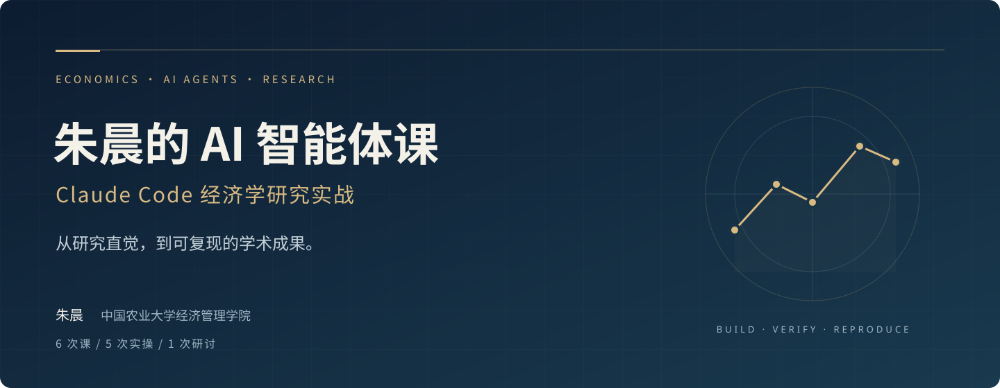

<p align="center"></p>

<h1 align="center">朱晨的 AI 智能体课</h1>
<p align="center"><strong>Claude Code 经济学研究实战</strong></p>

<p align="center">朱晨 · 中国农业大学经济管理学院<br>公众号「遗传社科研究」</p>

<p align="center"><a href="#open-research">开放研究宣言</a> · <a href="#curriculum">课程路径</a> · <a href="#materials">讲义与作业</a> · <a href="#start">开始学习</a> · <a href="#workflows">我的研究工具</a> · <a href="#connect">与我交流</a></p>

---

**这是一门写给经济学研究者的 AI 智能体实操课**，以 Claude Code 为主要工具，也可以改用 Codex。课程从安装讲起，逐步做到一条可复现的实证流程：数据采集与清理、计量分析、论文复现、理论建模和写作。每一步都要留下证据：表和图由脚本生成，数据处理有记录，关键数字经过独立核对。

| 课程形式 | 学习节奏 | 面向人群 |
| :--- | :--- | :--- |
| **6 次课 · 每次约 2 小时** | **5 次实操 + 1 次研讨** | **博士生 · 高年级硕士生 · 青年教师** |
| 讲义与现场演示 | 课后独立完成作业，配图文说明与作业包 | 有基本计量基础，掌握一种分析工具 |

<a id="open-research"></a>

## Open Research｜为什么我选择免费开放这门课

从大学开始，我的学习和研究受益于许多素未谋面的人。从最早的 BBS，开源的 R 包，到 GitHub 上公开的代码、教程与研究工作流，很多人愿意分享自己的积累，让我得以学习、尝试，并在他们的工作上继续前进。这门课，也是我对这份慷慨的一点回应。

**因此，我选择把这门 AI 课免费开放，让更多研究者能够接触、理解并使用这些方法。** 我希望一个人学习新工具的机会，尽可能少地取决于 ta 所在的机构、拥有的经费，或能否进入某个付费圈子。开放课程无法消除所有AI带来的差距，但至少可以降低一点门槛，让 AI 带来的研究能力被更多人分享，减少新的不平等。

我也希望，这份开放能够通过你继续传递。如果这里的材料对你有帮助，欢迎把它介绍给需要的人；当你积累了自己的代码、经验或改进，也希望你愿意在尊重数据授权与他人成果的前提下，把可以公开的部分分享出来。一次纠错、一份清楚的说明、一个可复现的例子，都能成为别人向前走的一小步。

**我期待的科研社区，是知识可以流动、方法可以检验、工具可以共同改进的社区。** 希望 AI 的发展让这样的社区更开放，让更多人有机会参与，而不是让资源与工具越来越集中在少数人手中。愿我们从开放中受益，也一起让开放延续下去。

<a id="curriculum"></a>

## 课程安排

| 课次 | 研究主题与现场演示 | 你将完成的成果 |
| :---: | :--- | :--- |
| **01** | **从大语言模型到智能体**<br>写 CLAUDE.md，用 Plan mode 完成一个小任务 | 安装、写自己的 CLAUDE.md、完成一个核对过的任务 |
| **02** | **从一个模糊的想法到一张可用在论文中的图表**<br>小红书评论采集：智能体操作浏览器，人扫码登录 | 从空文件夹到一张能复现的图（世界银行数据或社媒评论） |
| **03** | **微观调查数据：审查、清理、合并**<br>用 research harness 清理 CHNS，生成 codebook | 审查报告、清理后的面板、带变量定义的 codebook |
| **04** | **计量识别与论文复现，写出第一个 Skill**<br>CHARLS 长护险 staggered DID；一篇论文的复现 | DID 或复现结果，以及你自己写的 SKILL.md |
| **05** | **理论建模、写作与可审计性**<br>用 pAI-Econ 构建理论模型；clean-room 审稿 | 加固后的复制包（capstone） |
| **06** | **研讨：AI 与经济学知识生产**<br>HLER 的设计原理；APE 项目案例讨论 | 一页立场备忘录：2036 年我还靠什么做研究 |

<a id="materials"></a>

## 讲义与作业

**目前已发布第 1–3 课资料。** 第 4–6 课资料待更新。

| 课次 | 课程名称 | 课堂讲义 | 图文作业说明 | 作业包 | 在线浏览 |
| :---: | :--- | :---: | :---: | :---: | :---: |
| **01** | 从大语言模型到智能体 | [PDF](lesson01/第1课_朱晨的AI智能体课_从大语言模型到智能体.pdf) | [PDF](lesson01/第1课课后作业使用说明.pdf) | [zip](lesson01/lab1_starter.zip) | [打开目录](lesson01/lab1_starter/) |
| **02** | 从一个模糊的想法到一张可用于论文的图表 | [PDF](lesson02/第2课_朱晨的AI智能体课_从一个模糊的想法到一张可用在论文中的图表.pdf) | [PDF](lesson02/第2课课后作业使用说明.pdf) | [zip](lesson02/lab2_starter.zip) | [打开目录](lesson02/lab2_starter/) |
| **03** | 微观调查数据：审查、清理、合并 | [PDF](lesson03/第3课_朱晨的AI智能体课_微观调查数据的审查清理合并.pdf) | [PDF](lesson03/第3课课后作业使用说明.pdf) | [zip](lesson03/lab3_starter.zip) | [打开目录](lesson03/lab3_starter/) |
| **04** | 计量识别与论文复现，写出第一个 Skill | 待更新 | 待更新 | 待更新 | — |
| **05** | 理论建模、写作与可审计性 | 待更新 | 待更新 | 待更新 | — |
| **06** | 研讨：AI 与经济学知识生产 | 待更新 | 待更新 | 待更新 | — |

<details>
<summary><strong>每课资料怎么用？查看文件说明</strong></summary>

每课资料按「**讲义 → 图文操作说明 → 作业包 → 验收清单**」使用。

以第 1 课为例，`lesson01/` 里有：

| 文件 | 用途 |
| --- | --- |
| `第1课_朱晨的AI智能体课_从大语言模型到智能体.pdf` | 讲义 |
| `第1课课后作业使用说明.pdf` | 课后作业的图文操作说明，第一次用终端的同学先看这份 |
| `lab1_starter.zip` | 作业包，下载后解压使用 |
| `lab1_starter/` | 作业包内容，可以在网页上直接浏览 |

</details>

<a id="start"></a>

## 开始学习

1. 按第 1 课的作业说明（见上表）装好环境：Claude Code（或 Codex）、Python 或 Stata、Git。
2. 每一课先看讲义，再按作业说明完成作业，最后对照验收清单自查。
3. **现在就申请数据。** 第 3、4 课要用 CHNS 或 CHARLS，请按各数据官网的流程自行申请下载，可能需要几天到几周。

## 先修要求

- 会用 Stata 或 R/Python 中的一种，了解基本的计量方法。
- 不需要用过 Claude Code 或其他智能体工具。
- 面向博士生、高年级硕士生和青年教师。本科生建议先用传统方式打好专业基础。

<details>
<summary><strong>使用 Codex 的同学：材料适配与联网设置</strong></summary>

课程材料按 Claude Code 组织（`CLAUDE.md`、`.claude/skills/`）。用 Codex 的同学可以让它读取这些文件，自动生成对应的 `AGENTS.md`，提示见各课作业包里的 `codex_adapt_prompt.md`。

Codex 默认的沙箱不允许终端命令联网，下载数据的脚本会报错（Windows 上是 `WinError 10013`）。在 `~/.codex/config.toml` 里加上下面两行，然后重启 Codex：

```toml
[sandbox_workspace_write]
network_access = true
```

</details>

## 数据与研究规范

- 课程无法分发任何数据。CHNS、CHARLS 等授权数据请自行申请，不得分享，不得上传到公开仓库。
- 第 1、2 课的基础作业只用世界银行等机构的公开数据。
- 社交媒体数据只用于个人学习和研究。采集时遵守平台用户协议，控制频率，个人信息去标识化，原始数据不公开。

<a id="workflows"></a>

## 从我的研究工作流，到你的研究工作台

课程中会用到我开发的以下项目。结合每一课的任务，理解它们如何组织研究过程，再逐步改造成适合自己课题的工具。

| 仓库 | 用途 | 课次 |
| --- | --- | --- |
| [claudecode-research-harness-workflow](https://github.com/maxwell2732/claudecode-research-harness-workflow) | 可审计、可复现的实证研究流程：审查、清理、计划、执行、审阅、发布 | 2、3、5 |
| [codex-stata-for-economists](https://github.com/maxwell2732/codex-stata-for-economists) | Stata 计量分析流水线 | 4、5 |
| [paper-replicate-agent-demo](https://github.com/maxwell2732/paper-replicate-agent-demo) | 论文复现 | 4 |
| [pAI-Econ-claude](https://github.com/maxwell2732/pAI-Econ-claude) | 经济学理论模型构建 | 5 |
| [hler-working-papers](https://github.com/maxwell2732/hler-working-papers) | HLER 人机协作研究系统的工作论文 | 6 |

## 致谢与参考

本课程主要参考了以下材料：

- Barrios, John M. *Claude Code for Accounting Research*. Yale School of Management, 2026. 课程网站：https://johnmbarrios.com/claude-code-accounting/ ；
- Sant'Anna, Pedro H. C. *claude-code-my-workflow*. https://github.com/pedrohcgs/claude-code-my-workflow


<a id="connect"></a>

---

<p align="center"></p>
<p align="center"><strong>朱晨 · 遗传社科研究</strong><br>经济学研究 × AI 智能体 × 可复现工作流</p>
<p align="center">欢迎关注公众号「遗传社科研究」，交流研究与实践。<br>课程问题与建议，请在 <a href="https://github.com/maxwell2732/chenzhu-claude-econ/issues">Issues</a> 留言；更多项目见 <a href="https://github.com/maxwell2732">我的 GitHub</a>。</p>
